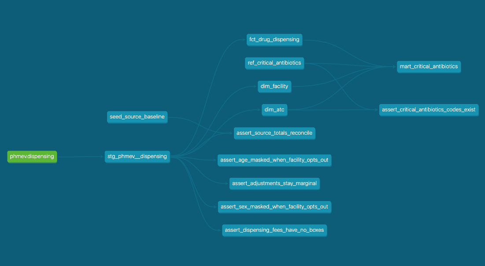

# 💊 Open Health Data ELT Pipeline

[](https://getdbt.com)
[](https://duckdb.org)
[]()
[](LICENSE)

> ELT pipeline turning raw French open health data (3.5M drug dispensing
> records) into a **standardized, tested and documented analytical warehouse**
> for public-health research — with ontology-based harmonization (WHO ATC),
> automated data quality and full lineage.

**Author**: [Zahia Yanes](https://www.linkedin.com/in/zahia-yanes) — Health Data & AI Engineer

---

## 🎯 Objective

Open PHMEV (drugs prescribed in hospitals and dispensed in community
pharmacies, published by the French National Health Insurance) ships as a raw
yearly CSV dump: no referential integrity, no documented missingness, no
analytical model.

This project builds the missing layer:

- **Ingest** the raw source into a partitioned Parquet landing zone
- **Harmonize** it against the WHO ATC classification
- **Model** a tested, documented dimensional warehouse
- **Serve** a reproducible antimicrobial stewardship indicator

---

## 🏗️ Architecture

```
┌──────────────┐    ┌──────────────┐    ┌──────────────┐    ┌──────────────┐
│  Open PHMEV  │───▶│  Ingestion   │───▶│   Landing    │───▶│     dbt      │
│  raw CSV     │    │  Python      │    │   Parquet    │    │  staging →   │
│  3.5M rows   │    │  (chunked)   │    │  partitioned │    │  marts       │
│              │    │              │    │  55 MB       │    │  42 tests    │
└──────────────┘    └──────────────┘    └──────────────┘    └──────┬───────┘
                                                                   │
                                        ┌──────────────────────────┤
                                        │                          │
                              ┌─────────▼────────┐     ┌───────────▼──────┐
                              │   Star schema    │     │  Public health   │
                              │   dim_atc        │     │  indicator       │
                              │   dim_facility   │     │  (ATC J01)       │
                              │   fct_dispensing │     └──────────────────┘
                              └──────────────────┘
```

Local engine: **DuckDB** — free, zero setup, 3.5M rows built and tested in
3 seconds. All transformation logic lives in dbt SQL, so a Snowflake target can
be added without touching a single model.

### Lineage



Generated by `dbt docs generate`: the dependency graph is derived from the
code, never maintained by hand. Data quality tests are nodes of the graph, not
a script on the side.

---

## 🔍 Data Quality Issues Found

Every issue below was **measured on the full 3.5M-row file**, not assumed.

| Issue | Finding | Severity |
|---|---|---|
| Encoding | cp1252, not latin-1 (corrupted right quotes) | 🟡 WARNING |
| Hidden missingness | Values masked with sentinels (9999999, 99, 9), reported as 0% NULL | 🔴 CRITICAL |
| Non-random masking | Masking correlates with the reporting facility | 🔴 CRITICAL |
| Numeric parsing | French thousands separator silently dropped 13% of rows — **96% of monetary value** | 🔴 CRITICAL |
| Out-of-scope rows | Pharmacist dispensing fees mixed with drugs | 🟡 WARNING |
| Negative values | Legitimate accounting adjustments, not errors | 🔵 INFO |
| Reference integrity | ATC codes outnumber ATC labels at every level | 🟡 WARNING |
| Perimeter | IV-only antibiotics structurally absent (community-pharmacy scope) | 🔵 INFO |

---

## 📊 Source Facts

| Property | Value |
|---|---|
| Rows | 3,534,234 |
| Landing zone | 55 MB Parquet, partitioned by year |
| Primary key | Full dimensional tuple (11 columns, validated unique) |
| Prescribing facilities | 1,153 |
| Facility axis | 100% populated |
| ATC level 5 | 90.8% disclosed |
| Age band | 71.9% disclosed |
| Sex | 37.5% disclosed — **not usable as an analysis axis** |
| Reconciled totals | 306,537,393 boxes · EUR 12,508,778,299.18 reimbursed |

### Two-tier statistical disclosure control

Masking operates at two levels, verified with **zero violations** on the full
file:

1. **Facility opt-out** — when the facility does not report sex, the value is
   masked in 100% of its rows
2. **Row-level small-cell suppression** — even when the facility does report,
   40.6% of sex values are still masked

Masking is therefore **not missing at random**. No imputation is performed, and
every aggregate reports the share of data it could not resolve.

---

## ✅ Data Quality Framework

42 automated tests, including:

| Test | What it guards |
|---|---|
| `unique` on the surrogate key | Grain integrity over 3.5M rows |
| `relationships` on both dimensions | Star schema referential integrity |
| `assert_source_totals_reconcile` | **Cross-engine** reconciliation: pandas pipeline vs independent csv/Decimal baseline |
| `assert_age/sex_masked_when_facility_opts_out` | Disclosure rule derived from the data, 0 violations |
| `assert_adjustments_stay_marginal` | Detects a parsing regression through distribution drift |
| `assert_critical_antibiotics_codes_exist` | Reference list matches observed ATC codes |

---

## 🧪 Health Indicator — Antimicrobial Stewardship

Share of **critical antibiotics** (classes whose excessive use most strongly
drives bacterial resistance) among all systemic antibacterials (ATC J01), by
type of prescribing facility.

| Facility type | Critical share | Unresolved class |
|---|---|---|
| CH (general hospitals) | 44.5% | 1.3% |
| ESPIC | 37.5% | 1.7% |
| CHU (teaching hospitals) | 37.1% | 0.3% |
| CLCC (cancer centres) | 32.3% | 3.1% |
| HL (local hospitals) | 27.9% | **25.9%** ⚠️ |

The **unresolved class** column is published alongside the indicator on
purpose: for local hospitals, a quarter of the volume has its therapeutic class
masked at source, so their figure is not interpretable. Without that column, a
reader would conclude that local hospitals prescribe the fewest critical
antibiotics.

*Methodological notes: the indicator is a ratio within ATC J01, so the
box-as-unit bias largely cancels out. The numerator is dominated by J01CR
(amoxicillin-clavulanate): it describes broad-spectrum prescribing pressure,
not last-line antibiotic use. The reference list is provisional, pending
verification against the official ANSM list.*

---

## 💡 Engineering Lessons

1. **Profile before modeling.** The first 50k rows were unrepresentative: the
   file is sorted by ATC class.
2. **0% NULL does not mean complete.** Statistical disclosure control hides
   missingness behind sentinel codes.
3. **A quality check that depends on the component it validates is not a
   quality check.** The first reconciliation test passed while 13% of rows were
   being lost, because baseline and pipeline shared the same buggy parser.
4. **Completeness ratios understate impact.** 13% of rows lost meant 96% of
   monetary value lost — only a total reconciliation exposed it.
5. **A failing test is often a discovery.** Negative values were not errors:
   the test was wrong, not the data.
6. **Publish the limits next to the number.** An indicator without its
   reliability indicator invites a false conclusion.

---

## 🚀 Getting Started

```bash
git clone git@github.com:ZahiaYanes/open-health-data-elt.git
cd open-health-data-elt

python -m venv .venv && source .venv/bin/activate
make install

# Download OPEN_PHMEV_2025.CSV from data.ameli.fr into data/raw/
make ingest
make build          # build and test everything
make docs           # browse the data dictionary and lineage graph
make check          # pre-commit repository checks
```

---

## 📂 Project Structure

```
open-health-data-elt/
├── ingestion/          # Python: profiling, ingestion, independent baseline
│   ├── profile_source.py      # schema, encoding, value domains
│   ├── scan_source.py         # full-file scan, true value domains
│   ├── resolve_grain.py       # primary key and coding semantics
│   ├── compute_baseline.py    # reconciliation baseline (independent impl.)
│   └── sources/phmev.py       # production ingestion
├── transform/          # dbt: staging → marts, tests, reference models
├── scripts/            # query helper, pre-commit checks
├── docs/adr/           # Architecture Decision Records
└── Makefile
```

---

## 🗺️ Roadmap

- [x] Source profiling, grain resolution, ingestion
- [x] dbt staging layer and data quality framework
- [x] Dimensional model (star schema)
- [x] First public-health indicator
- [ ] CI/CD with GitHub Actions
- [ ] Orchestration with Airflow
- [ ] Snowflake target provisioned with Terraform
- [ ] RAG assistant over the dbt catalog

---

## 📝 License

MIT License — Copyright (c) 2025 Zahia Yanes

---

> ⚠️ Research and portfolio project. Indicators are derived from public
> aggregated data and are not intended for clinical or regulatory use.